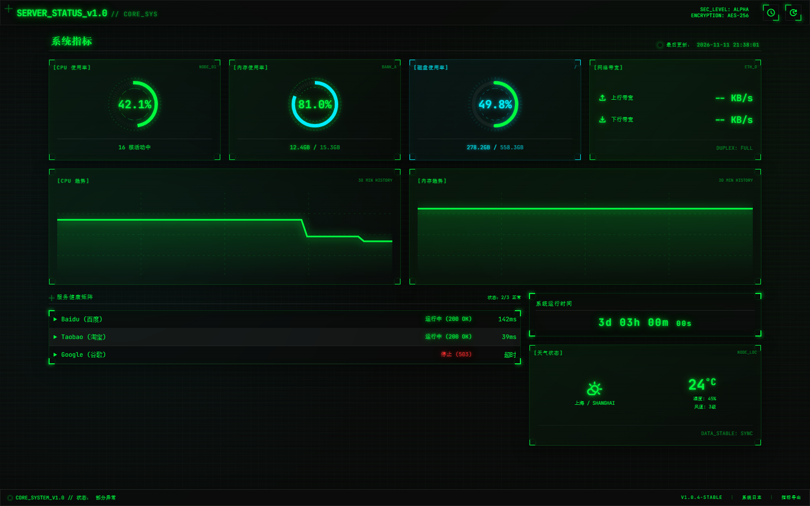

# 轻量级服务监控大屏（go语言）

一个用 **Go + Gin** 编写的实时监控大屏：在浏览器里一屏展示本机硬件资源占用（CPU / 内存 / 磁盘 / 运行时间），以及外部依赖站点（百度、淘宝、Google）的存活状态与响应延迟。

编译后是**单个可执行文件**，前端页面由同一个进程直接托管，不需要数据库、不需要 Node.js / 前端构建，双击即跑。



---

## 一、项目类型

| 维度 | 说明 |
| --- | --- |
| 项目形态 | **B/S 架构的 Web 应用**（Go 后端 + 单页 HTML 前端） |
| 应用类型 | 轻量级 **服务器 / 服务监控大屏**（Monitoring Dashboard） |
| 开发性质 | Go 语言课程结课作业（个人独立完成） |
| 部署方式 | 单二进制 + 一个 HTML 文件，无外部依赖，可离线内网运行 |
| 视觉风格 | 深色「赛博终端 / 黑客帝国」HUD 风，霓虹绿 + CRT 扫描线 |

它不是框架脚手架或 CRUD 后台，而是一个**数据采集 + HTTP 接口 + 实时渲染**的小型系统工具。

---

## 二、功能清单

**系统指标监控（每秒刷新）**

- CPU 总体使用率（%）、逻辑核心数
- 内存总量 / 已用量 / 使用率
- 磁盘总量 / 已用量 / 使用率（Linux 取 `/`，Windows 自动回退到 `C:`）
- 系统已运行时长（Uptime，换算成 `Xd XXh XXm XXs`）

**外部服务健康检查（每 5 秒刷新）**

- 对配置好的 URL 列表发起 HTTP GET，判定 `up`（2xx/3xx）或 `down`
- 记录单次请求响应耗时（ms），超时阈值 5 秒
- 并发检测，逐个站点显示状态与延迟

**前端大屏**

- 环形进度条（SVG `stroke-dasharray`）显示百分比，超过 70% 变青色、90% 变红色
- CPU / 内存 60 点趋势折线，数据在浏览器端滑动窗口累积
- 全站深色 HUD 主题、扫描线、霓虹发光，纯 CDN 引入 Tailwind CSS，零构建

---

## 三、技术栈

| 模块 | 选型 | 说明 |
| --- | --- | --- |
| 语言 | Go 1.21+ | 并发模型与静态编译是主要卖点 |
| Web 框架 | [Gin](https://github.com/gin-gonic/gin) v1.9.1 | 路由 + JSON 序列化 + 请求日志 |
| 系统信息 | [gopsutil/v3](https://github.com/shirou/gopsutil) | 跨平台读取 CPU / 内存 / 磁盘 / Uptime |
| 前端 | 原生 HTML + Tailwind CSS (CDN) | 无需 npm、无需打包 |
| 通信 | 原生 `fetch` 轮询 | 比 WebSocket 简单，1s / 5s 两档间隔 |

---

## 四、目录结构

```
server-status-dashboard/
├── main.go                 # 全部后端逻辑：路由、指标采集、健康检查
├── dashboard.html          # 大屏页面（由程序以相对路径读取并返回）
├── go.mod / go.sum         # 依赖声明
├── docs/
│   ├── REQUIREMENTS.md     # 需求文档（功能、接口契约、技术选型）
│   └── screenshot.png      # 运行效果截图
└── ui/
    ├── code.html           # 早期 UI 高保真原型（静态稿，不参与运行）
    └── DESIGN.md           # 设计规范说明
```

> `ui/` 属于设计阶段的产物，保留下来是为了展示从原型到实现的迭代过程，**运行时不依赖它**。

---

## 五、快速开始

### 1. 环境要求

- Go **1.21** 或更高版本（`go version` 检查）
- 能访问外网（健康检查要请求百度 / 淘宝 / Google）

### 2. 拉取依赖并运行

```bash
# 进入项目目录
cd server-status-dashboard

# 首次运行先拉取依赖（可选，go run 也会自动处理）
go mod download

# 直接运行
go run .
```

看到下面的输出说明启动成功：

```
=== Server Status Dashboard ===
  Local:  http://localhost:8686
  API:    http://localhost:8686/api/system
  API:    http://localhost:8686/api/services
[GIN-debug] Listening and serving HTTP on :8686
```

### 3. 打开大屏

浏览器访问 👉 <http://localhost:8686>

### 4. 编译成可执行文件（可选）

```bash
# Windows
go build -o dashboard.exe .
./dashboard.exe

# Linux / macOS
go build -o dashboard .
./dashboard
```

⚠️ **注意**：程序通过相对路径 `dashboard.html` 读取页面，所以**必须在项目根目录下启动**，否则首页会 404。分发时把 `dashboard.exe` 和 `dashboard.html` 放在同一目录即可。

---

## 六、接口说明

### `GET /api/system` — 系统硬件状态

```json
{
  "code": 200,
  "data": {
    "cpu_percent": 32.4,
    "cores": 16,
    "memory_total_gb": 15.3,
    "memory_used_gb": 12,
    "memory_percent": 78,
    "disk_total_gb": 558.3,
    "disk_used_gb": 278.2,
    "disk_percent": 49.8,
    "uptime_hours": 75
  }
}
```

### `GET /api/services` — 外部服务状态

```json
{
  "code": 200,
  "data": [
    { "name": "Baidu (百度)", "url": "https://www.baidu.com", "status": "up", "latency_ms": 166 },
    { "name": "Taobao (淘宝)", "url": "https://www.taobao.com", "status": "up", "latency_ms": 195 },
    { "name": "Google (谷歌)", "url": "https://www.google.com", "status": "down", "latency_ms": 0 }
  ]
}
```

`status` 只有 `up` / `down` 两种；`down` 时 `latency_ms` 记为 0。

---

## 七、实现要点

1. **CPU 采样与请求解耦**
   `cpu.Percent(time.Second, false)` 本身要阻塞 1 秒，如果放在接口里，每个请求都会卡 1 秒。这里在 `init()` 起一个后台 goroutine 每秒采样一次，把结果四舍五入后写入包级缓存，接口只读缓存；读写用 `sync.RWMutex` 保护，接口响应降到微秒级。

2. **并发健康检查**
   多个站点用 `goroutine + sync.WaitGroup` 并发探测，结果按索引写回预分配的切片，总耗时等于最慢的那个站点，而不是逐个累加。

3. **超时控制**
   每个请求包 `context.WithTimeout(ctx, 5*time.Second)`，避免某个站点无响应时把整个接口拖死。

4. **跨平台磁盘路径**
   先试 Unix 风格的 `/`，报错再回退到 Windows 的 `C:`，同一份代码在两边都能跑。

5. **前端零依赖渲染**
   环形进度条用 SVG 的 `stroke-dasharray` 计算弧长；趋势图把数组拼成 SVG `path` 的 `d` 属性；轮询用 `setInterval`，系统指标 1s、服务状态 5s。

---

## 八、已知限制

- **网络速率与天气为占位数据**：页面上的「网络速率」卡片和「天气状况」卡片是 UI 原型遗留，后端并未提供 `net_up_kbs` / `net_down_kbs` 与天气接口，所以速率显示 `-- KB/s`，天气固定为 `24°C`。
- **Google 探测会拖慢接口**：国内网络访问 Google 通常超时，`/api/services` 会等满 5 秒才返回；如需流畅体验，可把 Google 从 `main.go` 的 `services` 列表中移除或换成可访问的地址。
- **端口写死**：监听端口 `8686` 硬编码在 `main.go` 的 `r.Run(":8686")`。
- **无鉴权、无持久化**：数据全部实时采集，不落库；适合本机或内网使用，不建议直接暴露到公网。
- 浏览器端趋势图数据只存在内存里，刷新页面后重新累积。

---

## 九、自定义

| 想改什么 | 改哪里 |
| --- | --- |
| 监控的站点列表 | `main.go` 中的 `var services = []struct{ Name, URL string }{...}` |
| 监听端口 | `main.go` 末尾的 `r.Run(":8686")` |
| 探测超时时间 | `checkService()` 里的 `context.WithTimeout(..., 5*time.Second)` |
| 前端刷新频率 | `dashboard.html` 底部 `setInterval(fetchSystem, 1000)` / `setInterval(fetchServices, 5000)` |
| 主题色 | `dashboard.html` 的 `<style>` 段，主色 `#00ff41`（霓虹绿）、辅色 `#00f3ff`（青） |

---

## License

仅用于学习与教学演示，可自由参考。
